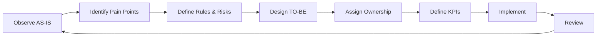

# Process Mapping Playbook

A practical set of templates for understanding a current process, designing a better target process, assigning ownership, defining controls, and measuring results.

## Why Process Mapping Matters

Good digital systems start with a clear understanding of how work actually moves through people, decisions, information, and exceptions.

## Playbook

| Template | Use |
|---|---|
| [AS-IS Process](templates/as-is-process.md) | Capture the current workflow and pain points |
| [TO-BE Process](templates/to-be-process.md) | Design the target workflow |
| [RACI](templates/raci.md) | Clarify responsibility and decision ownership |
| [KPI Definition](templates/kpi-definition.md) | Define how process performance will be measured |
| [Risk & Control](templates/risk-control.md) | Connect process risks to controls and evidence |

## Improvement Cycle

## Mapping Principles

- Map reality, not the idealized process
- Identify decisions, queues, handoffs, rework, and exceptions
- Separate value-adding steps from administrative friction
- Define who owns each action and decision
- Add controls where risk justifies them
- Measure outcomes after implementation

## License

MIT — reuse and adapt the templates.
